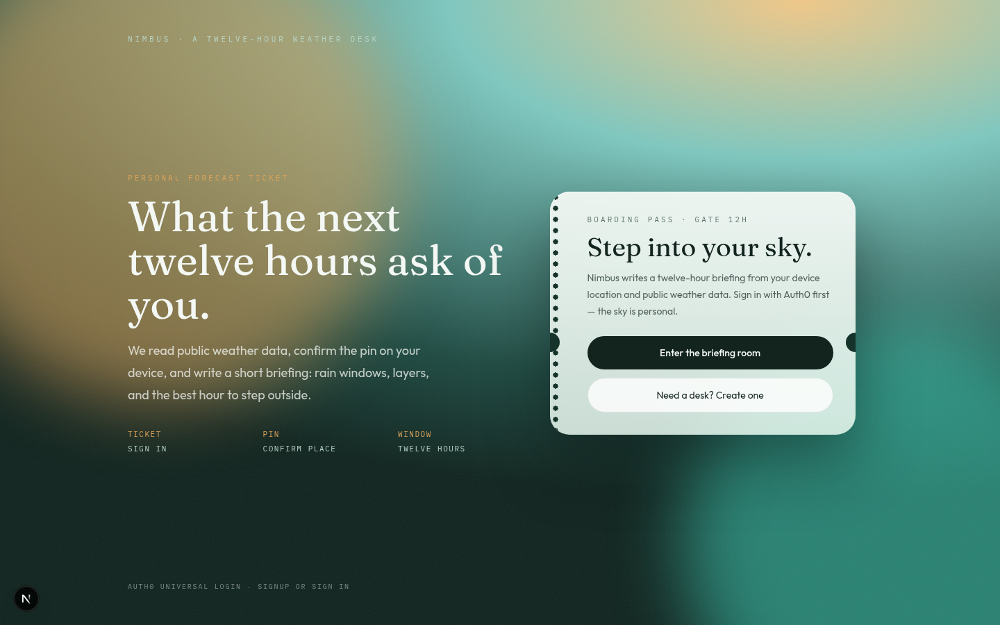
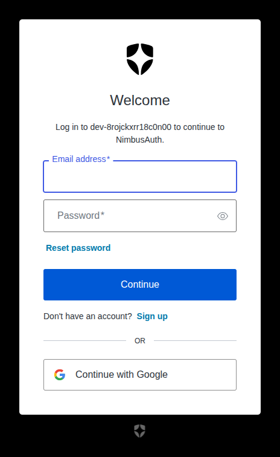
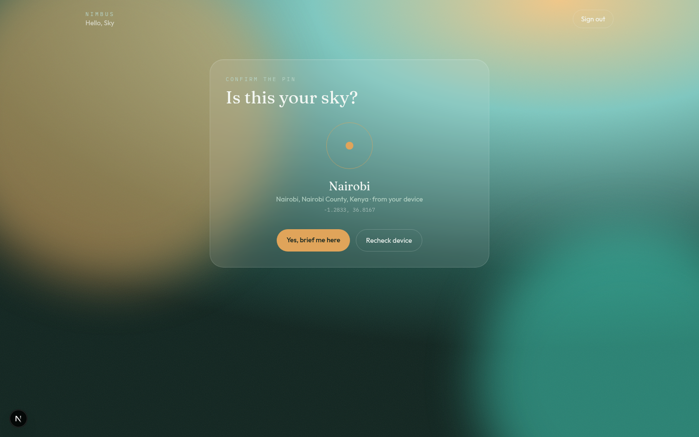
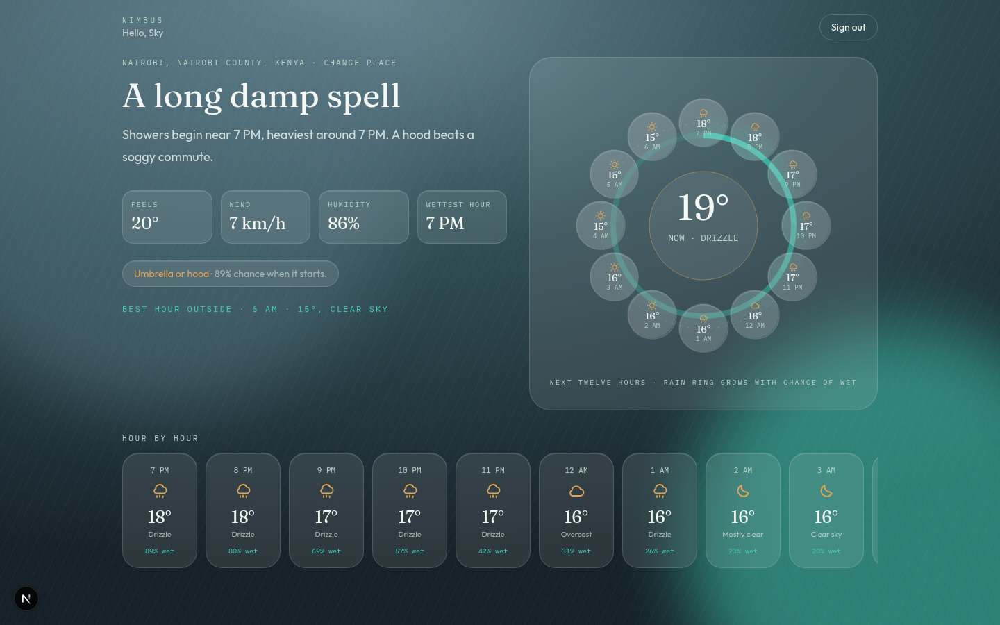

# Nimbus

Nimbus is a signed-in weather desk. It confirms where you are, reads the next twelve hours from public forecast data, and tells you what to carry — umbrella, jacket, or nothing at all.

After Auth0 login, the app asks your device for a location pin (or lets you search a city), then writes a short briefing with a 12-hour halo and hour-by-hour strip.

## What it does

1. **Sign in** through Auth0 Universal Login (email/password or Google).
2. **Confirm the pin** using device geolocation, or search a city if location is off.
3. **Read the sky** — temperature, rain chance, wind, humidity, and a packing note for the next 12 hours.

The briefing is generated from [Open-Meteo](https://open-meteo.com/) (no API key). Place names come from device reverse geocoding and Open-Meteo’s geocoding search.

## Screenshots

### Sign in

The boarding-pass ticket is the front door. **Enter the briefing room** logs you in; **Need a desk? Create one** opens Auth0 signup.



Auth0 Universal Login handles the actual credentials:



### Confirm location

Nimbus names the pin from your device, then asks you to confirm it before fetching weather.



### Twelve-hour briefing

A headline, kit chips, the 12-hour halo (the rain ring grows with chance of wet), and an hour-by-hour strip.



## How to run it

### 1. Install

```bash
npm install
```

### 2. Environment

Copy `.env.example` to `.env.local` (or keep the existing file) and set:

| Variable | Purpose |
| --- | --- |
| `APP_BASE_URL` | App origin, e.g. `http://localhost:3000` |
| `AUTH0_DOMAIN` | Your Auth0 tenant domain |
| `AUTH0_CLIENT_ID` | Auth0 application client ID |
| `AUTH0_CLIENT_SECRET` | Auth0 application client secret |
| `AUTH0_SECRET` | Random 32-byte hex string used to encrypt the session cookie |

Generate a session secret with:

```bash
openssl rand -hex 32
```

Paste `AUTH0_CLIENT_SECRET` from the Auth0 dashboard (Applications → your app → Settings). Do not commit `.env.local`.

This Auth0 application is configured for origin `http://localhost:3000/`:

- Callback URL: `http://localhost:3000/auth/callback`
- Logout URL: `http://localhost:3000/`

If you run on another host or port, those URLs must match in Auth0 or login/logout will fail.

### 3. Start the app

```bash
npm run dev -- --port 3000
```

Open [http://localhost:3000](http://localhost:3000).

### 4. Try the flow

1. Click **Need a desk? Create one** (or **Enter the briefing room** if you already have an account).
2. Complete Auth0 Universal Login.
3. Allow location, or search a city.
4. Confirm the place and read the next twelve hours.
5. **Sign out** ends the Auth0 session and returns you to the ticket.

## Stack

- **Next.js 16** (App Router) and React 19
- **Auth0 Next.js SDK** (`@auth0/nextjs-auth0`) for server-side login and sessions
- **Open-Meteo** for the 12-hour forecast
- Device **Geolocation API**, with city search as a fallback
